# ToDo Full Stack · Seguridad con Spring Security y JWT

**Escuela Colombiana de Ingeniería Julio Garavito** · Desarrollo y Operaciones de Software (DOSW)

Aplicación de gestión de tareas con **React + Spring Boot + PostgreSQL (Docker)**, extendida con cuentas de usuario, autenticación con **JWT firmado**, tareas privadas por usuario y un recurso exclusivo para el rol `ADMIN`.

| Recurso | Enlace |
|---|---|
| Informe de seguridad (12 preguntas) | [`docs/informe-seguridad-jwt.md`](docs/informe-seguridad-jwt.md) |
| Informe del laboratorio base (CRUD) | [`docs/informe-laboratorio.md`](docs/informe-laboratorio.md) |

---

## 1. Alcance

**Estado inicial:** un CRUD de tareas (React + Spring Boot + PostgreSQL) donde cualquiera podía ver y modificar todas las tareas. Evidencia en [`01-estado-inicial-crud.png`](docs/evidence/01-estado-inicial-crud.png).

**Lo que se agregó (se extendió la app existente, no se creó otra):**

- Registro e inicio de sesión de usuarios.
- Contraseñas almacenadas con **BCrypt**.
- Emisión de un **JWT firmado (HS256)** con duración de 30 minutos y validación en cada petición.
- **Tareas privadas:** cada usuario solo lista, consulta, crea, edita y elimina las suyas.
- Rol `ADMIN` con un endpoint de resumen agregado (`/api/v1/admin/summary`).
- Frontend React con registro, login, tareas protegidas y cierre de sesión.
- Migración de base de datos que **conserva las tareas anteriores**.

---

## 2. Requerimientos implementados

| Código | Requerimiento | Dónde se implementa | Evidencia |
|---|---|---|---|
| RF-SEG-01 | Registrar usuario | `AuthController`, `AuthService` | [08](docs/evidence/08-pruebas-registro-auth.png), [09](docs/evidence/09-registro-curl.png) |
| RF-SEG-02 | Autenticar y emitir JWT | `AuthController`, `JwtService` | [11](docs/evidence/11-pruebas-jwt.png), [12](docs/evidence/12-login-y-me-con-token.png) |
| RF-SEG-03 | Sesión en React con el token | `AuthContext`, `api/http.js` | [20](docs/evidence/20-react-tareas-ana.png) |
| RF-SEG-04 | Consultar perfil propio | `UserController` (`/users/me`) | [12](docs/evidence/12-login-y-me-con-token.png) |
| RF-SEG-05 | Proteger el CRUD | `SecurityConfig` | [13](docs/evidence/13-sin-token-401.png), [14](docs/evidence/14-token-alterado-401.png) |
| RF-SEG-06 | Aislar tareas por usuario | `TaskServiceImpl`, `TaskRepository` | [16a](docs/evidence/16a-aislamiento-por-usuario.png), [16b](docs/evidence/16b-aislamiento-por-usuario.png), [18](docs/evidence/18-tareas-por-dueno-postgres.png) |
| RF-SEG-07 | Endpoint solo `ADMIN` | `SecurityConfig`, `AdminController` | [17](docs/evidence/17-admin-403-y-200.png) |
| RF-SEG-08 | Cerrar sesión en React | `AuthContext.logout` | [21](docs/evidence/21-react-aislamiento-luis.png) |
| RF-SEG-09 | Errores de seguridad diferenciados | `GlobalExceptionHandler`, `SecurityConfig` | sección 7 |
| RF-SEG-10 | Validar con pruebas | 90 pruebas backend + 22 frontend | [19](docs/evidence/19-pruebas-react-auth.png), [22](docs/evidence/22-pruebas-seguridad-backend.png), [23](docs/evidence/23-jacoco-seguridad.png) |

### Historias de usuario y criterios de aceptación

**HU-SEG-01 · Registro**

```gherkin
Escenario: Registro exitoso
  Dado que no existe una cuenta con el correo "ana@example.com"
  Cuando registro mi nombre, correo y una contraseña válida
  Entonces se crea una cuenta con rol USER
  Y la contraseña se almacena mediante un hash seguro
  Y la respuesta no contiene la contraseña ni su hash

Escenario: Correo duplicado
  Dado que ya existe una cuenta con el correo "ana@example.com"
  Cuando intento registrarme nuevamente con ese correo
  Entonces la API responde 409 Conflict
  Y no se crea un segundo usuario
```

**HU-SEG-02 · Inicio de sesión**

```gherkin
Escenario: Credenciales válidas
  Dado que tengo una cuenta activa
  Cuando envío mi correo y contraseña correctos
  Entonces la API responde 200 OK
  Y recibo un access token JWT firmado con expiración

Escenario: Credenciales inválidas
  Dado que tengo una cuenta registrada
  Cuando envío una contraseña incorrecta
  Entonces la API responde 401 Unauthorized
  Y no se entrega un access token
```

**HU-SEG-03 · Acceso a las tareas propias**

```gherkin
Escenario: Consultar tareas propias
  Dado que Ana y Luis tienen tareas registradas
  Y he iniciado sesión como Ana
  Cuando consulto GET /api/v1/tasks usando mi JWT
  Entonces recibo únicamente las tareas pertenecientes a Ana

Escenario: Intentar modificar una tarea ajena
  Dado que la tarea 25 pertenece a Luis
  Y he iniciado sesión como Ana
  Cuando intento modificar PUT /api/v1/tasks/25
  Entonces el servidor rechaza la operación con 404
  Y la tarea de Luis permanece sin cambios
```

**HU-SEG-04 · Protección de recursos**

```gherkin
Escenario: Petición sin token
  Cuando consulto GET /api/v1/tasks sin Authorization
  Entonces la API responde 401 Unauthorized

Escenario: Token manipulado o expirado
  Dado que el token fue alterado o expiró
  Cuando consulto GET /api/v1/tasks con ese token
  Entonces la API responde 401 Unauthorized
```

**HU-SEG-05 · Recurso administrativo**

```gherkin
Escenario: Acceso administrativo autorizado
  Dado que mi cuenta tiene rol ADMIN
  Cuando consulto GET /api/v1/admin/summary
  Entonces la API responde 200 OK con métricas agregadas

Escenario: Usuario sin privilegios
  Dado que tengo un JWT válido con rol USER
  Cuando consulto GET /api/v1/admin/summary
  Entonces la API responde 403 Forbidden
```

**HU-SEG-06 · Sesión en React**

```gherkin
Escenario: Cierre de sesión
  Dado que he iniciado sesión
  Cuando presiono "Log out"
  Entonces se elimina el token del estado de la aplicación
  Y se ocultan mis tareas
  Y se muestra la pantalla de inicio de sesión
```

> El cierre de sesión es **del lado del cliente**: no revoca un JWT ya emitido, que sigue siendo válido hasta su expiración si alguien lo conserva. Se explica en el [informe](docs/informe-seguridad-jwt.md) (pregunta 10).

---


## 3. Arquitectura (C4)

Los diagramas corresponden al código entregado. Están en Mermaid y GitHub los renderiza.

### Nivel 1 · Contexto

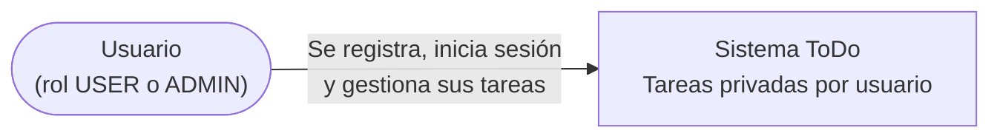

### Nivel 2 · Contenedores

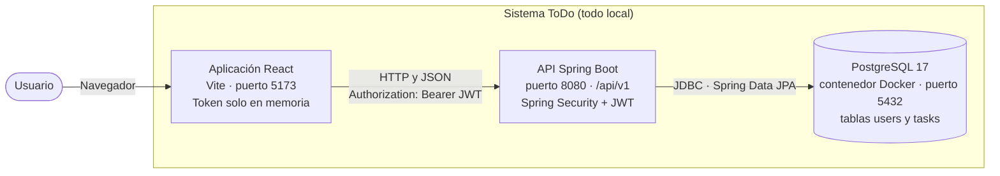

### Nivel 3 · Componentes de la API

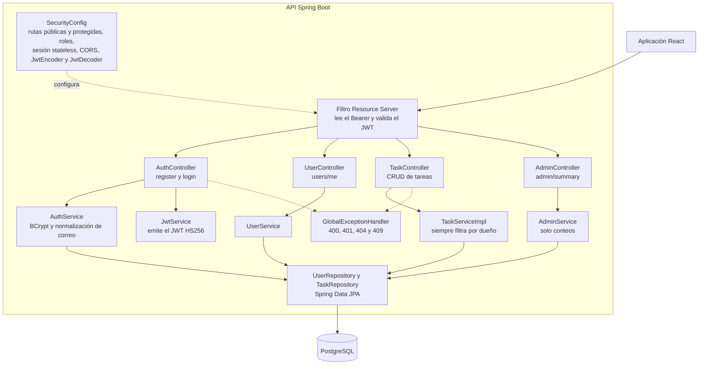

---

## 4 Diagrama de clases y modelo entidad-relación

### Diagrama de clases

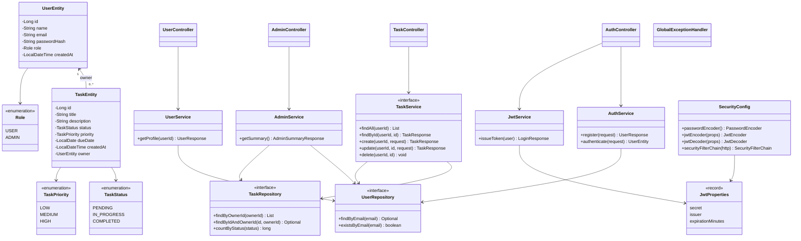

**Dónde está cada responsabilidad:**

| Responsabilidad | Clase |
|---|---|
| Entidades de persistencia | `UserEntity`, `TaskEntity` |
| Repositorios | `UserRepository`, `TaskRepository` |
| Registro y verificación de credenciales | `AuthService` |
| Emisión del JWT | `JwtService` (usa el `JwtEncoder`) |
| Validación del JWT y reglas de acceso | `SecurityConfig` (`JwtDecoder`, `SecurityFilterChain`) |
| Aislamiento por dueño | `TaskServiceImpl` + `TaskRepository` |
| Controladores REST | `AuthController`, `UserController`, `TaskController`, `AdminController` |
| DTOs (sin secretos) | `RegisterRequest`, `LoginRequest`, `LoginResponse`, `UserResponse`, `Task*Request/Response`, `AdminSummaryResponse` |
| Errores centralizados | `GlobalExceptionHandler` |

### Modelo entidad-relación

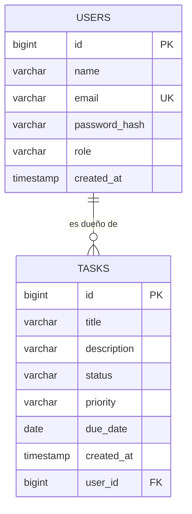

Script de migración: [`database/002_add_users_security.sql`](database/002_add_users_security.sql). Las tareas anteriores **no se borran**: se crea el usuario `legacy@todo.local` (con un hash que no es BCrypt válido, así que nadie puede iniciar sesión con él), se le asignan las tareas existentes y solo entonces `user_id` pasa a `NOT NULL` con llave foránea e índice.

---

## 5. Flujo de autenticación con JWT

### Inicio de sesión

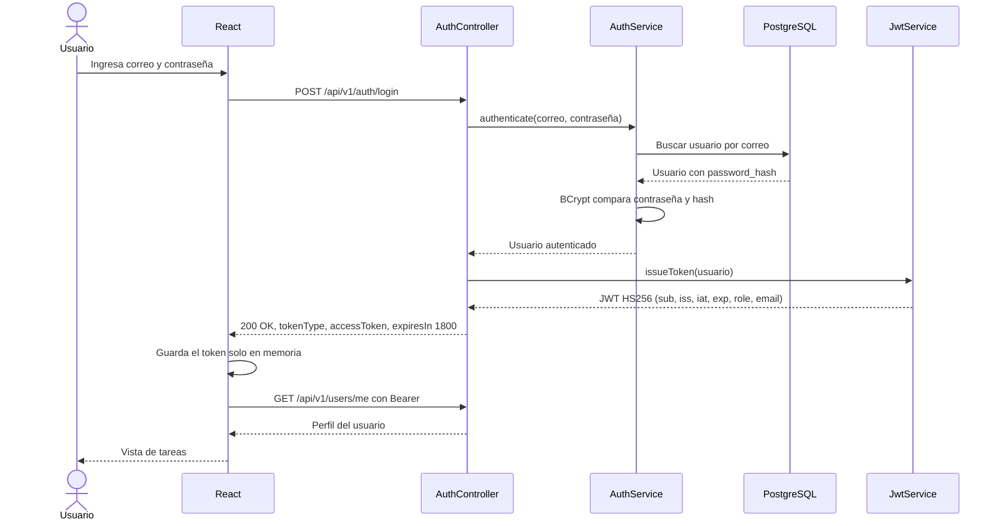

### Petición protegida (tareas de un usuario)

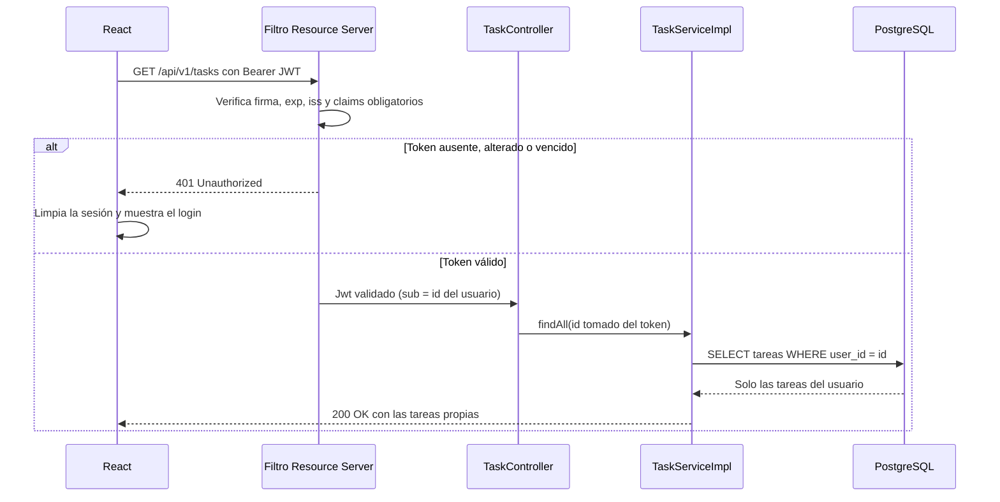

---

## 6. Contrato de endpoints

| Método | Endpoint | Acceso | Resultado |
|---|---|---|---|
| `POST` | `/api/v1/auth/register` | Público | `201` con `id`, `name`, `email`, `role` (siempre `USER`) |
| `POST` | `/api/v1/auth/login` | Público | `200` con `tokenType`, `accessToken`, `expiresIn` |
| `GET` | `/api/v1/users/me` | Autenticado | `200` con el perfil propio |
| `GET` | `/api/v1/tasks` | Autenticado | `200` solo con las tareas propias |
| `GET` | `/api/v1/tasks/{id}` | Autenticado | `200`; `404` si es ajena o no existe |
| `POST` | `/api/v1/tasks` | Autenticado | `201`; el dueño sale del token |
| `PUT` | `/api/v1/tasks/{id}` | Autenticado | `200`; `404` si es ajena o no existe |
| `DELETE` | `/api/v1/tasks/{id}` | Autenticado | `204`; `404` si es ajena o no existe |
| `GET` | `/api/v1/admin/summary` | Solo `ADMIN` | `200` con métricas agregadas |

Ejemplo de respuesta de `GET /api/v1/admin/summary` (no incluye tareas ni correos):

```json
{
  "totalUsers": 3,
  "totalAdmins": 1,
  "totalTasks": 7,
  "tasksByStatus": { "PENDING": 4, "IN_PROGRESS": 2, "COMPLETED": 1 }
}
```

### Política de errores

| Situación | Código |
|---|---|
| Datos inválidos en registro, creación o actualización | `400 Bad Request` |
| Registro con correo ya existente | `409 Conflict` |
| Login inválido | `401 Unauthorized` |
| Falta de token, token expirado, alterado o de otro emisor | `401 Unauthorized` |
| JWT válido sin el rol `ADMIN` en el recurso administrativo | `403 Forbidden` |
| Tarea inexistente o de otro usuario | `404 Not Found` |

---

## 7. Decisiones de seguridad

| Tema | Decisión |
|---|---|
| **Firma del JWT** | HS256 (llave simétrica). La misma configuración criptográfica sirve para emitir y validar. La llave exige mínimo 32 caracteres. |
| **Validación** | En cada petición: firma, `exp` (sin margen de tolerancia), `iss` y claims obligatorios (`sub`, `iat`, `exp`). Decodificar el Base64 no basta. |
| **Duración** | 30 minutos. Al vencer, el backend responde `401` y React vuelve al login. |
| **Claims** | `sub` (id del usuario), `iss`, `iat`, `exp`, `role`, `email`. El `role` se convierte en `ROLE_USER` o `ROLE_ADMIN`. |
| **Contraseñas** | BCrypt mediante `PasswordEncoder`. Entre 8 y 72 caracteres (72 es el límite de BCrypt). Nunca se devuelven ni se guardan en texto plano. |
| **Roles** | El registro público siempre crea `USER`. Un `ADMIN` solo se crea en local por base de datos (sección 9). `/api/v1/admin/**` exige `ROLE_ADMIN`. |
| **Identidad** | El backend toma el usuario del claim `sub` del token validado, nunca de un id enviado por el cliente. |
| **Aislamiento** | `TaskServiceImpl` consulta siempre con `findByIdAndOwnerId`. Tarea ajena e inexistente responden igual (`404`) para no revelar que existe. |
| **Sesiones** | `STATELESS`; CSRF desactivado porque la API no usa cookies. |
| **Frontend** | El token vive solo en memoria (variable del módulo): no se usa `localStorage` ni cookies. Al recargar la página se pierde la sesión y se pide login otra vez. |
| **CORS** | Solo se permite el origen `http://localhost:5173` en `/api/v1/**`. |
| **Errores** | `GlobalExceptionHandler` y el `AuthenticationEntryPoint` separan `400`, `401`, `403`, `404` y `409`. |
| **Secretos** | `JWT_SECRET` sale de una variable de entorno. Sin ella el backend no arranca, a propósito. `.env` está en `.gitignore` y `.env.example` no trae valores. |
| **Logs** | El código no escribe tokens, contraseñas ni la cabecera `Authorization`. |

**Limitaciones conocidas:**

- El cierre de sesión no revoca el token ya emitido (se explica en el informe).
- Con HS256 quien conozca la llave puede emitir tokens; es aceptable en local, no para varios servicios.
- La contraseña de la base de datos (`todo_password`) y `show-sql=true` vienen del laboratorio base y son solo para uso local.

---

## 8. Ejecutar localmente

### Requisitos

Docker, Java 21, Node.js y npm.

### 1. Base de datos (Docker)

```bash
docker start todo-postgres
```

Si el contenedor no existe, se crea una sola vez:

```bash
docker pull postgres:17-alpine
docker volume create todo-postgres-data
docker run -d --name todo-postgres -e POSTGRES_DB=todo_db -e POSTGRES_USER=todo_user -e POSTGRES_PASSWORD=todo_password -p 5432:5432 -v todo-postgres-data:/var/lib/postgresql/data postgres:17-alpine
```

Aplica los scripts en orden (el 002 solo una vez):

```bash
docker cp database/001_create_schema.sql todo-postgres:/001_create_schema.sql
docker exec -i todo-postgres psql -U todo_user -d todo_db -f /001_create_schema.sql
docker cp database/002_add_users_security.sql todo-postgres:/002_add_users_security.sql
docker exec -i todo-postgres psql -U todo_user -d todo_db -f /002_add_users_security.sql
```

### 2. Variables de entorno

| Variable | Obligatoria | Descripción |
|---|---|---|
| `JWT_SECRET` | **Sí** | Llave de firma del JWT, mínimo 32 caracteres. Nunca se sube a GitHub. |
| `DB_URL`, `DB_USER`, `DB_PASSWORD` | No | Tienen valores por defecto para el PostgreSQL local de Docker. |
| `VITE_API_BASE_URL` | No | URL base de la API para el frontend (por defecto `http://localhost:8080/api/v1`). |

Ver [`.env.example`](.env.example). En PowerShell, genera una llave aleatoria que vive solo en esa terminal:

```powershell
$b = New-Object byte[] 48; [System.Security.Cryptography.RandomNumberGenerator]::Create().GetBytes($b); $env:JWT_SECRET = [Convert]::ToBase64String($b)
```

### 3. Backend (en la misma terminal donde definiste `JWT_SECRET`)

```powershell
cd backend
.\mvnw.cmd spring-boot:run
```

### 4. Frontend

```powershell
cd frontend
npm install
npm run dev
```

Abre `http://localhost:5173`.

### 5. Crear una cuenta ADMIN (solo desarrollo local)

El registro público **nunca** crea administradores. Para probar `/api/v1/admin/summary`:

1. Registra una cuenta normal desde la aplicación (por ejemplo `admin@example.com`) con una contraseña que elijas tú. No se publica ninguna contraseña en el repositorio.
2. Promuévela directamente en la base de datos local:

```powershell
docker exec -it todo-postgres psql -U todo_user -d todo_db -c "UPDATE users SET role = 'ADMIN' WHERE email = 'admin@example.com';"
```

3. **Inicia sesión de nuevo.** El rol viaja dentro del token y un token emitido antes de la promoción sigue diciendo `USER`.

Esto no es una elevación pública de privilegios: requiere acceso directo a la base de datos.

### 6. Pruebas

```powershell
cd backend
.\mvnw.cmd clean verify          # pruebas + reporte JaCoCo
start target\site\jacoco\index.html

cd ..\frontend
npm test
```

Las pruebas del backend no necesitan `JWT_SECRET`: usan una llave de prueba propia y una base H2 en memoria.

---

## 9. Evidencia del funcionamiento

| Qué demuestra | Captura |
|---|---|
| Migración 002 aplicada | 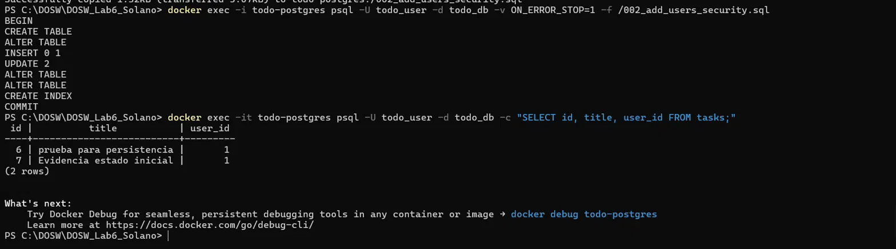 |
| Contraseña guardada como hash en PostgreSQL | 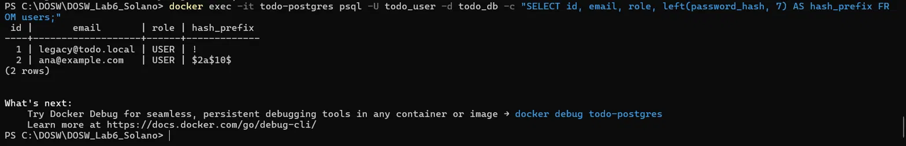 |
| Login con JWT (token parcial) y `/users/me` | 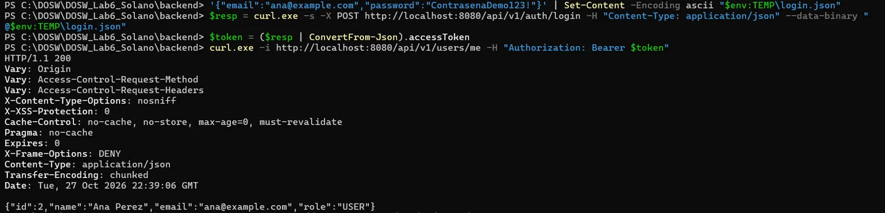 |
| Sin token → 401 | 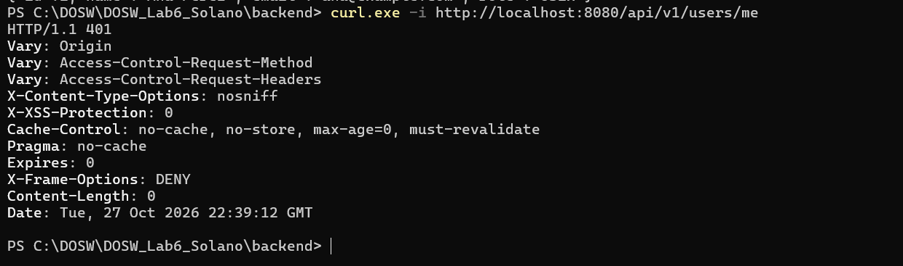 |
| Token alterado → 401 | 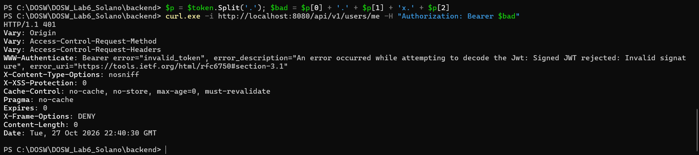 |
| Aislamiento por usuario (Ana y Luis) | 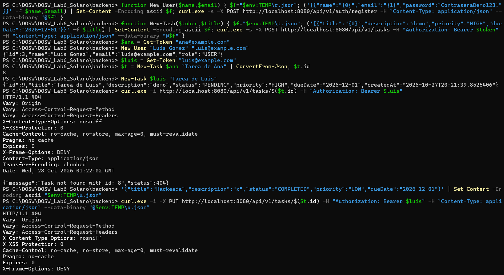 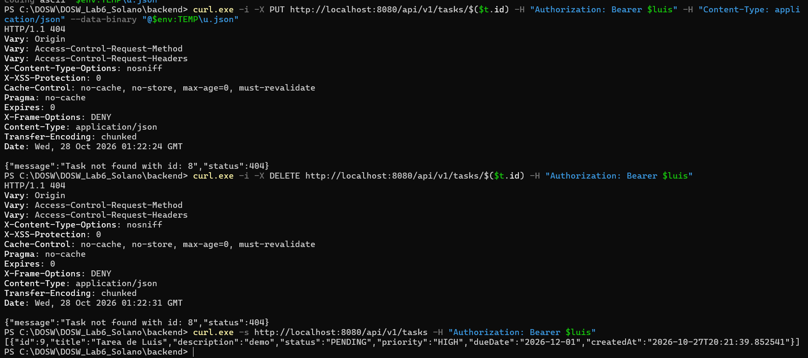 |
| `USER` → 403 y `ADMIN` → 200 en `/admin/summary` | 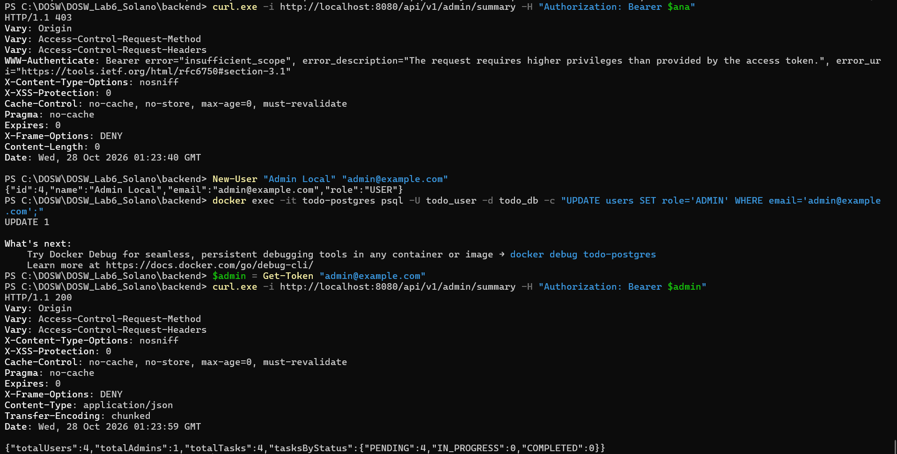 |
| Tareas con dueños distintos en PostgreSQL | 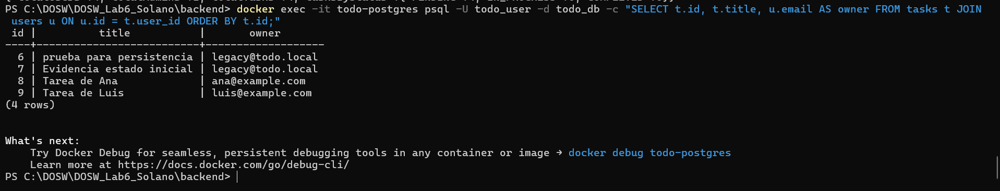 |
| React: tareas de Ana | 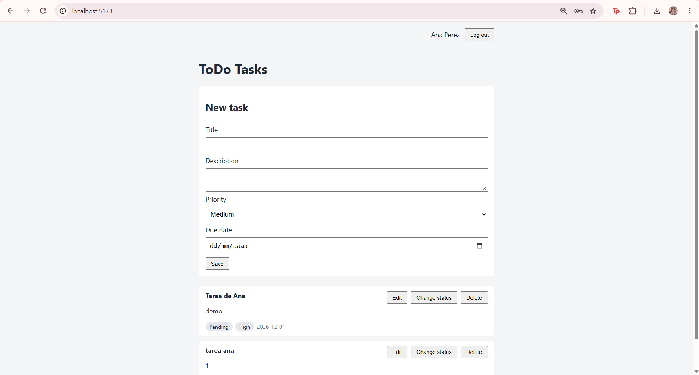 |
| React: Luis no ve las tareas de Ana | 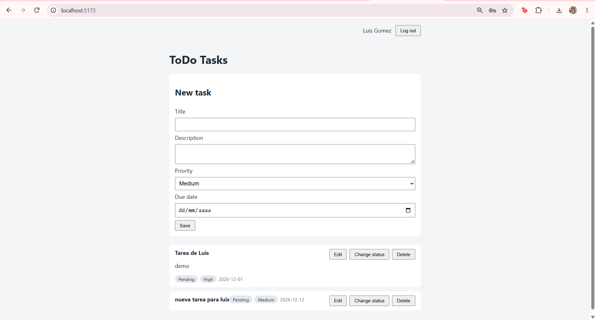 |

---

## 10. Resultados de las pruebas y cobertura

| Suite | Resultado | Captura |
|---|---|---|
| Backend (JUnit 5, Mockito, MockMvc, H2) | **90 pruebas, 0 fallos** | 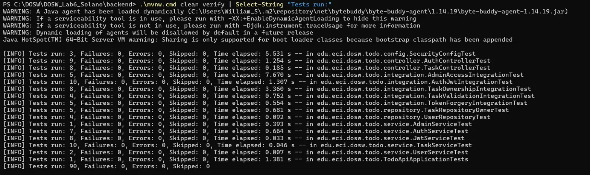 |
| Frontend (Vitest, React Testing Library) | **22 pruebas, 0 fallos** | 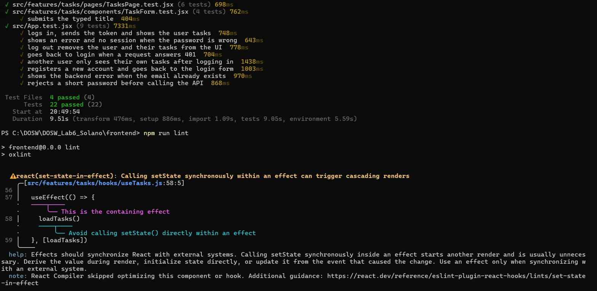 |

**Cobertura JaCoCo (backend):** 97 % de instrucciones, 75 % de ramas (4 de 16 sin cubrir, sobre todo condiciones internas de `SecurityConfig`) y 100 % de líneas, métodos y clases en `service`, `controller` y `dto`.

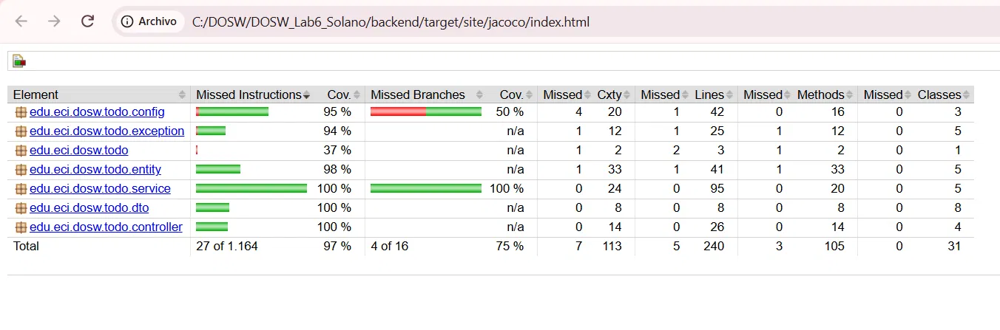

> La cobertura no reemplaza la validación de escenarios de seguridad. Lo que demuestra la seguridad son las pruebas de la matriz siguiente.

### Matriz de pruebas

| ID | Prueba | Resultado | Dónde está |
|---|---|---|---|
| PT-01 | Registrar usuario válido | `201`, rol `USER` | `AuthControllerTest.register_withValidData_returns201WithoutPassword` |
| PT-02 | Correo duplicado | `409`, sin duplicados | `AuthControllerTest.register_withDuplicateEmail_returns409` |
| PT-03 | Guardar contraseña | Hash, no texto plano | `AuthServiceTest.register_storesPasswordAsHash_notPlainText` |
| PT-04 | Login correcto | `200` con token firmado | `AuthJwtIntegrationTest.login_withValidCredentials_returnsSignedToken` |
| PT-05 | Login incorrecto | `401` sin token | `AuthJwtIntegrationTest.login_withWrongPassword_returns401WithoutToken` |
| PT-06 | Tareas sin token | `401` | `AuthJwtIntegrationTest.tasks_withoutToken_returns401` |
| PT-07 | Tareas con token válido | `200`, solo las propias | `TaskOwnershipIntegrationTest.list_returnsOnlyTheTasksOfEachUser` |
| PT-08 | Token modificado | `401` | `TokenForgeryIntegrationTest.tasks_withTamperedToken_returns401` |
| PT-09 | Token expirado | `401` | `TokenForgeryIntegrationTest.tasks_withExpiredToken_returns401` |
| PT-10 | Consultar tarea ajena | `404` sin filtrar datos | `TaskOwnershipIntegrationTest.getForeignTask_returns404_withoutLeakingData` |
| PT-11 | Modificar tarea ajena | `404`, sin cambios en BD | `TaskOwnershipIntegrationTest.updateForeignTask_returns404_andDatabaseIsUnchanged` |
| PT-12 | Eliminar tarea ajena | `404`, la tarea sigue | `TaskOwnershipIntegrationTest.deleteForeignTask_returns404_andTaskStillExists` |
| PT-13 | Crear tarea autenticado | Dueño correcto | `TaskOwnershipIntegrationTest.createTask_assignsTheAuthenticatedUserAsOwner` |
| PT-14 | `USER` en `/admin/summary` | `403` | `AdminAccessIntegrationTest.summary_withUserRole_returns403` |
| PT-15 | `ADMIN` en `/admin/summary` | `200` | `AdminAccessIntegrationTest.summary_withAdminRole_returns200WithAggregatedMetrics` |
| PT-16 | Cerrar sesión en React | Token y tareas desaparecen | `App.test.jsx` · "log out removes the user and their tasks from the UI" |
| PT-17 | `401` en una petición React | Redirige al login | `App.test.jsx` · "goes back to login when a request answers 401" |
| PT-18 | Otro usuario inicia sesión | Solo ve sus tareas | `App.test.jsx` · "another user only sees their own tasks after logging in" |

Pruebas adicionales de seguridad: token firmado con otra llave que dice ser `ADMIN` y token con el `role` editado de `USER` a `ADMIN` (ambos `401`), registro público que no puede crear `ADMIN`, y validación `400` en creación y edición de tareas.


---

## 11. CI/CD multinube (Azure y AWS)

> Esta sección documenta el pipeline de integración y despliegue del laboratorio CI/CD multinube. Los diagramas C4 de contenedores y de despliegue, el flujo CI/CD, la tabla de pipelines y la guía de Compose local se integran desde el trabajo del resto del equipo.

### Comparación Azure y AWS

Las dos nubes ejecutan exactamente el mismo stack (`infra/docker-compose.prod.yml`: PostgreSQL, API, frontend y Caddy) con las mismas imágenes de GHCR etiquetadas por SHA. Lo único que cambia es la máquina que lo aloja y la configuración propia de cada entorno.

| Aspecto | Azure | AWS Academy |
|---|---|---|
| Dónde corre Docker Compose | Máquina virtual de Azure | Instancia EC2 |
| Runner de GitHub | `azure-todo` | `aws-todo` |
| Workflow | `CD - Azure VM` | `CD - AWS Academy EC2` (`.github/workflows/deploy-aws.yml`) |
| Environment de GitHub | `azure-lab` | `aws-lab` |
| Secretos | `AZURE_DB_PASSWORD`, `AZURE_JWT_SECRET` | `AWS_DB_PASSWORD`, `AWS_JWT_SECRET` |
| Variable de dominio | `AZURE_DOMAIN` | `AWS_DOMAIN` |
| Carpeta de despliegue | `~/todo-azure` | `~/todo-aws` |
| Tamaño de la máquina | Standard_B2s (2 vCPU, 4 GiB) | t3.medium (2 vCPU, 4 GiB) |
| Usuario SSH | `azureuser` | `ubuntu` |
| Cómo se apaga | Stop hasta ver "Stopped (deallocated)" | End Lab en el Learner Lab |
| ¿Se reconstruye la imagen en la máquina? | No, se descarga de GHCR | No, se descarga de GHCR |
| Almacenamiento de PostgreSQL | Volumen Docker local a la VM | Volumen Docker local a la EC2 |

**Qué no cambia:** el código, las dos imágenes (`-api` y `-web`) y su etiqueta SHA, el compose, el Caddyfile, los scripts SQL de `database/`, la verificación posterior al despliegue (`/health` con 200 y `/api/v1/tasks` sin token con 401) y las reglas de seguridad (solo 80 y 443 abiertos al público, nunca 5432 ni 8080).

**Justificación de la arquitectura:**

- **Máquinas virtuales con Docker Compose** en vez de servicios gestionados: el laboratorio busca entender el despliegue de punta a punta con las mismas piezas en cualquier nube, y las cuentas educativas limitan los servicios disponibles.
- **Runners self-hosted dentro de cada máquina:** el despliegue ocurre en el propio servidor, así que el workflow no necesita credenciales de la nube (ni claves de acceso de AWS ni de Azure).
- **Imágenes inmutables por SHA en GHCR:** garantizan que ambas nubes ejecutan el mismo commit verificado por el CI y permiten volver a una versión anterior cambiando `IMAGE_TAG`.
- **Bases de datos independientes por nube:** cada stack tiene su propio volumen y sus propios secretos. Una tarea creada en una nube no aparece en la otra, y un token JWT de una nube no es válido en la otra.
- **Caddy con HTTPS automático** sobre un dominio `IP.sslip.io`, sin depender de un dominio propio.

### Evidencias y video

Las evidencias están en [`docs/ci-cd-evidencias/`](docs/ci-cd-evidencias/).

**Integración continua y calidad**

- Pruebas del backend: [`01-backend-tests.png`](docs/ci-cd-evidencias/01-backend-tests.png)
- Cobertura de JaCoCo con umbral: [`02-jacoco-reporte.png`](docs/ci-cd-evidencias/02-jacoco-reporte.png) y [`03-jacoco-umbral-80.png`](docs/ci-cd-evidencias/03-jacoco-umbral-80.png)
- Análisis estático de Java: [`04-spotbugs-resultado.png`](docs/ci-cd-evidencias/04-spotbugs-resultado.png)
- Pruebas y cobertura del frontend: [`05-frontend-tests-cobertura.png`](docs/ci-cd-evidencias/05-frontend-tests-cobertura.png) y [`06-vitest-reporte-html.png`](docs/ci-cd-evidencias/06-vitest-reporte-html.png)
- Análisis estático de React con ESLint: [`19-eslint-hallazgo.png`](docs/ci-cd-evidencias/19-eslint-hallazgo.png), [`20-eslint-limpio.png`](docs/ci-cd-evidencias/20-eslint-limpio.png) y [`21-ci-log-eslint.png`](docs/ci-cd-evidencias/21-ci-log-eslint.png) (las capturas 07 y 18 corresponden a la herramienta anterior, oxlint)
- Pipeline en verde: [`11-ci-jobs-verdes.png`](docs/ci-cd-evidencias/11-ci-jobs-verdes.png)
- Fallo controlado y corrección: [`12-ci-fallo-controlado-rojo.png`](docs/ci-cd-evidencias/12-ci-fallo-controlado-rojo.png) y [`13-ci-corregido-verde.png`](docs/ci-cd-evidencias/13-ci-corregido-verde.png)

**Contenedores e imágenes**

- Construcción de las imágenes: [`08-docker-build-api.png`](docs/ci-cd-evidencias/08-docker-build-api.png) y [`09-docker-build-web.png`](docs/ci-cd-evidencias/09-docker-build-web.png)
- Validación del compose productivo: [`22-compose-config-ok.png`](docs/ci-cd-evidencias/22-compose-config-ok.png)
- Publicación en `main`: [`23-ci-main-publica-imagenes.png`](docs/ci-cd-evidencias/23-ci-main-publica-imagenes.png)
- Imágenes en GHCR con etiqueta SHA: [`24a-ghcr-api.png`](docs/ci-cd-evidencias/24a-ghcr-api.png) y [`24b-ghcr-web.png`](docs/ci-cd-evidencias/24b-ghcr-web.png)

